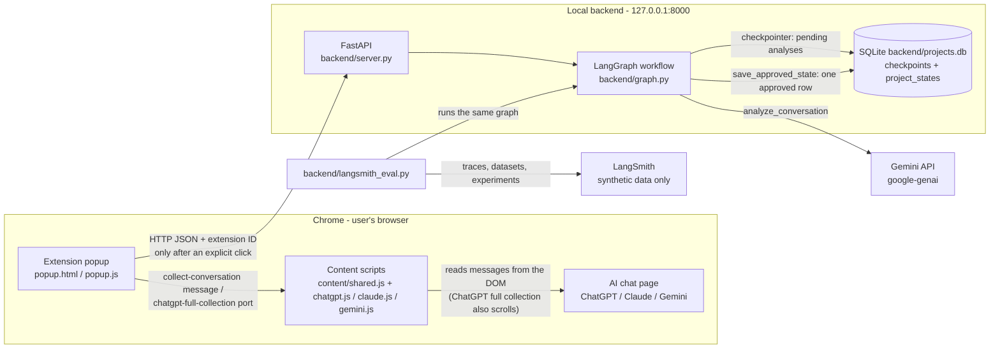
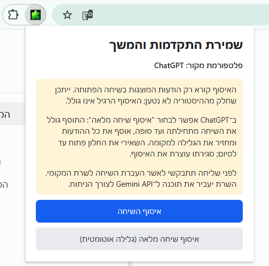
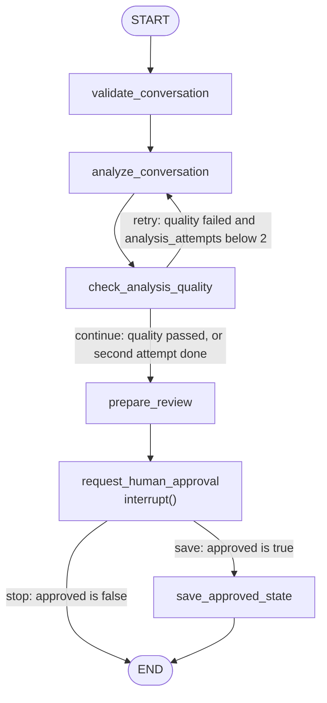
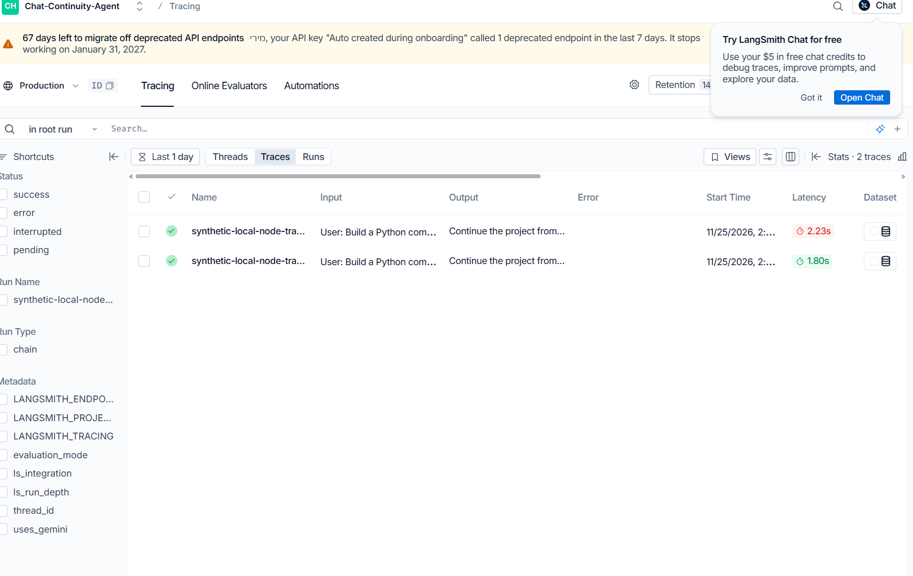
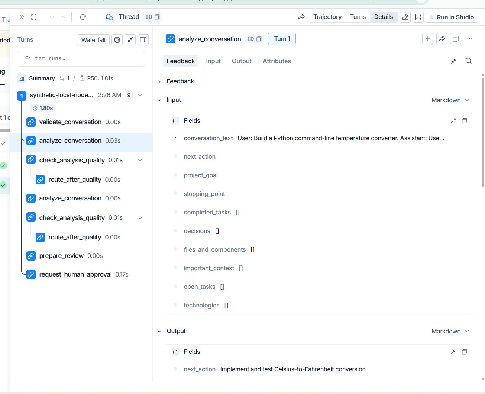

# Chat Continuity Agent

Long conversations with AI models lose context, and starting a new
conversation means explaining the project again. Chat Continuity Agent takes
an existing ChatGPT, Claude or Gemini conversation, analyzes it with a
LangGraph agent backed by the Gemini API, and produces a structured project
snapshot and a **continuation prompt**. After the user approves it, the user
copies the prompt into a new conversation. The prompt is never sent to an AI
model automatically.

## Technologies

| Technology | Role |
|---|---|
| Chrome extension (Manifest V3, JavaScript) | Collects the conversation from the page, asks for consent, shows the review |
| Python + FastAPI | Local server on `127.0.0.1:8000` |
| LangGraph | Agent workflow: analysis, quality loop, human approval, saving |
| Gemini API (`google-genai`) | Extracts the project information from the conversation |
| SQLite | LangGraph checkpoints and the approved project |
| LangSmith | Traces, Dataset, automatic evaluation, before/after experiments |

## Architecture



How it works:

1. The user clicks **איסוף השיחה**. The content script reads the user and
   assistant messages in page order and the popup shows their count. On
   ChatGPT, **איסוף שיחה מלאה (גלילה אוטומטית)** scrolls through long
   conversations, which ChatGPT renders only partially.
2. Only after a separate click on **אישור ושליחה לניתוח** does the popup send
   the transcript to `POST /conversations`. The server accepts requests only
   from the installed extension and runs the graph with LangSmith tracing
   disabled, so real conversations are not sent to LangSmith.
3. The graph analyzes the conversation with Gemini and pauses for approval.
   The popup shows the summary and the continuation prompt.
4. **אישור ושמירה** or **דחייה** calls
   `POST /conversations/{id}/approval`, which resumes the graph. If the popup
   was closed during the analysis, reopening it restores the review
   (`GET /conversations/{id}`).
5. After approval, **העתקת הפרומפט** copies the prompt for a new conversation.



*The popup on a ChatGPT conversation: the regular collection and, on ChatGPT
only, full collection with automatic scrolling.*

Extracted fields: `project_goal`, `important_context`, `decisions` (decision +
reason), `technologies`, `files_and_components`, `completed_tasks`,
`open_tasks`, `stopping_point`, `next_action`.

## LangGraph workflow

The diagram matches `build_graph()` in [backend/graph.py](backend/graph.py):
6 nodes, 5 fixed edges and 2 conditional routers. It was compared edge by edge
with the graph LangGraph generates from the code (`get_graph()`).



| Node | What it does |
|---|---|
| `validate_conversation` | Strips the transcript and rejects an empty one. |
| `analyze_conversation` | Calls Gemini with a JSON schema for the nine fields. The prompt treats the conversation as data, forbids invented information and keeps the conversation's language. The response is validated field by field. |
| `check_analysis_quality` | Increments `analysis_attempts`; sets `quality_passed` only if `project_goal`, `stopping_point` and `next_action` are filled, otherwise records the missing fields in `quality_feedback`. |
| `prepare_review` | Builds the `summary` and the `continuation_prompt`. |
| `request_human_approval` | Pauses the graph with `interrupt()` and returns the summary and prompt for review. |
| `save_approved_state` | Saves the approved state, without the transcript, to SQLite. |

- **Loop:** `route_after_quality` returns `retry` while quality failed and
  fewer than 2 attempts were made; the retry prompt includes the quality
  feedback. Gemini is called at most twice; if the second attempt still
  fails, the review continues with a visible quality warning.
- **Conditional branch:** `route_after_approval` returns `save` when the user
  approved and `stop` (END, nothing saved) when the user rejected.
- **interrupt and Human-in-the-Loop:** `interrupt()` stops the graph before
  anything is saved. The paused state is kept by the SQLite checkpointer, so
  the review survives a server restart. The server resumes it with
  `Command(resume={"approved": true|false})`. As an extra safeguard,
  `save_approved_state` refuses any state that is not approved
  (`PermissionError`).

The saved project is a single row: each new approval replaces the previous
one. An exception in a node (for example a Gemini error) ends the run; the
server returns a Hebrew error message to the popup and deletes the unfinished
checkpoint.

## LangSmith: Dataset, automatic evaluation and before/after experiment

All evaluation data is synthetic (invented conversations). No real user
conversation is sent to LangSmith.

`backend/langsmith_eval.py` has two modes:

| Mode | Dataset | Analyzer | Automatic evaluators |
|---|---|---|---|
| `mock` (default) | `Chat-Continuity-Agent-Synthetic-Context-v1`, 2 examples | Stubbed analyzer; no Gemini call. Its first answer deliberately omits `project_goal` to exercise the quality loop. | `exact_extraction_fields`: share of the 9 fields equal to the reference |
| `gemini` | `Chat-Continuity-Agent-Synthetic-Gemini-v1`, 4 examples (2 English, 2 Hebrew) | Real Gemini call through the real graph | `required_fields_filled`, `technology_recall`, `no_invented_technologies`, `files_recall`, `next_action_correct`, `language_preserved` |

Before/after experiments:

- **mock:** before = quality loop disabled; after = quality loop enabled.
- **gemini:** before = the original configuration (plain JSON mode, no quality
  loop); after = the improved configuration (JSON response schema + quality
  loop).

Measured results (2026-11-25):

| Experiment | Configuration | Result |
|---|---|---|
| `CCA-synthetic-before-quality-retry-3ee20c02` | mock, no retry | exact fields 0.889 |
| `CCA-synthetic-after-quality-retry-4d305245` | mock, with retry | exact fields 1.000 (+0.111) |
| `CCA-gemini-before-structured-output-95e8c1d2` | Gemini (`gemini-3.5-flash`), before | all 6 metrics 1.000, 0 failed runs |
| `CCA-gemini-after-structured-output-b3c733fe` | Gemini (`gemini-3.5-flash`), after | all 6 metrics 1.000, 0 failed runs |

The Gemini experiments used `gemini-3.5-flash` because the project's default
model, `gemini-3.8-flash`, returned 503 (overloaded) and then 429 (quota) that
day.

## LangSmith Traces

> **Synthetic data, not a real Gemini run.** The traces below are runs of
> `synthetic-local-node-trace-check`, created by `backend.langsmith_eval` in
> mock mode. They use an invented conversation and the stubbed analyzer, so
> `analyze_conversation` does not call Gemini (it takes 0.03 s in the trace).
> Real user conversations are never traced.

**Traces in the `Chat-Continuity-Agent` project.** Two successful runs; the
input is the synthetic conversation ("User: Build a Python command-line
temperature converter…") and the output is the generated continuation prompt
("Continue the project from…").



**One trace opened at `analyze_conversation`.** The left panel shows the run
tree of the graph; the right panel shows the node's input (the conversation
text and the still-empty project fields) and its output (the structured
fields, here `next_action`).



## Insights from LangSmith Traces

**From the trace above:** The trace demonstrates how the system transforms a
natural-language conversation into structured project state, including
decisions, completed tasks, and the next action. This helps preserve project
context and supports continuity across conversations. (In this synthetic
trace the structured output comes from the stubbed analyzer; in normal use
Gemini produces it.)

The same trace also makes the control flow visible: `analyze_conversation` and
`check_analysis_quality` each appear twice, because the stubbed analyzer's
first answer omits `project_goal` and the quality loop retries once. The run
then stops at `request_human_approval`, the human-approval interrupt, before
anything is saved.

### Insights from the experiment results

These come from the experiment results recorded in LangSmith (see the table
above), not from the trace screenshots:

1. **The mock experiment measures the mechanism, not the model.** The quality
   loop restores a deliberately removed `project_goal` (+0.111), which shows
   that the retry branch works. It says nothing about Gemini's extraction
   quality, which is why the Gemini mode was added.
2. **The synthetic dataset is too easy to separate the configurations.** With
   real Gemini, both configurations scored 1.000 on every metric, so the
   measured improvement is 0. The JSON schema is kept as a reliability
   safeguard (it guarantees the response shape). Measuring quality
   differences needs harder cases: longer conversations, decisions that
   change later, implicit stopping points and distracting technologies.

## Installation and running

Requirements: Windows, Python 3.11 or newer (developed with 3.13), Google
Chrome, a Gemini API key. Node.js is needed only for the extension tests.

1. Create the environment and install the dependencies (listed in
   `backend/pyproject.toml`), from the repository root in PowerShell:

   ```powershell
   py -m venv backend\.venv
   .\backend\.venv\Scripts\python.exe -m pip install fastapi langgraph langgraph-checkpoint-sqlite python-dotenv google-genai langsmith uvicorn
   ```

2. Create `backend/.env` (it is git-ignored; never commit it):

   ```
   GEMINI_API_KEY=<your key>
   # optional, see step 3:
   CHAT_CONTINUITY_EXTENSION_ID=<ID shown in chrome://extensions>
   # only for the LangSmith evaluation:
   LANGSMITH_TRACING=true
   LANGSMITH_PROJECT=Chat-Continuity-Agent
   LANGSMITH_API_KEY=<your key>
   ```

3. Load the extension: `chrome://extensions` → Developer mode → **Load
   unpacked** → the `extension` folder. The server accepts only this
   extension. `backend/server.py` contains the ID of this project's installed
   extension (`DEFAULT_EXTENSION_ID`); Chrome derives the ID from the folder,
   so on another computer set `CHAT_CONTINUITY_EXTENSION_ID` to the ID shown
   in `chrome://extensions`.

4. Start the server from the repository root (not from inside `backend`):

   ```powershell
   .\backend\.venv\Scripts\python.exe -m uvicorn backend.server:app --host 127.0.0.1 --port 8000
   ```

   The log shows `Allowed extension origin: chrome-extension://<id>`; it must
   match the ID in `chrome://extensions`.

5. Open a conversation, click the extension icon and follow the steps in
   [How it works](#architecture).

Run the LangSmith evaluation (needs the LangSmith settings in step 2; the
Gemini mode uses Gemini quota, at least 8 analyses per run):

```powershell
.\backend\.venv\Scripts\python.exe -m backend.langsmith_eval
.\backend\.venv\Scripts\python.exe -m backend.langsmith_eval --mode gemini --model gemini-3.5-flash
```

## Tests

```powershell
.\backend\.venv\Scripts\python.exe -m unittest backend.test_graph -v
node --test extension/tests/extractors.test.js extension/tests/popup.test.js
node --test extension/tests/chatgpt-browser.test.js
```

Without Node.js, set `$env:ELECTRON_RUN_AS_NODE = "1"` and replace `node`
with `& "$env:LOCALAPPDATA\Programs\Microsoft VS Code\Code.exe"`.
`chatgpt-browser.test.js` runs headless Chrome on a synthetic, virtualized
120-message ChatGPT page (`extension/tests/browser/`) and checks full
collection: order, no duplicates, forward-only scrolling and scroll
restoration (about 3–4 minutes).

Latest run (2026-11-25): 16/16 backend, 28/28 extension unit and 6/6
real-browser tests passed. Unit tests use a fake Gemini client and synthetic
pages.

## Verification status and limitations

Verified: the backend over real HTTP with a real Gemini analysis
(`gemini-3.5-flash`) of a synthetic conversation (send → review → restore →
approve → saved); the full HTTP flow with a fake Gemini client; the LangSmith
datasets and experiments above; ChatGPT collection on the live site; ChatGPT
full collection on the synthetic test page.

Not yet verified: ChatGPT full collection on a real long conversation;
collection from live Claude and Gemini conversations; the complete flow from
the installed extension in the browser; analysis with the default model
`gemini-3.8-flash`. The approved project is stored but not yet read back by
any endpoint. Extension-specific notes are in
[extension/README.md](extension/README.md).
